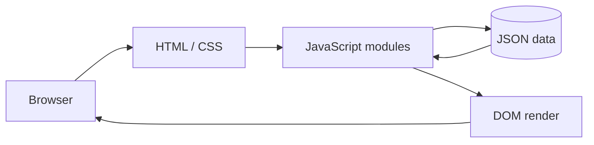

# 00 | START HERE — Resume Website

> **最短の学習目標:** 本サイトは「HTMLが骨格、CSSが見た目、JSONがデータ、JavaScriptがデータ取得・DOM構築」を分担する静的Webサイトである、と説明できるようになる。
>
> **注意:** 本サイトに登場する氏名、経歴、制作物はサンプル。実際の個人の経歴・実績を主張するものではない。

## 3分で全体像を理解する

訪問者が`index.html`を開くと、ブラウザが`assets/css/styles.css`でレイアウトを作り、`assets/js/main.js`を動かす。`main.js`は`fetch()`を使って`data/profile.json`と`data/projects.json`を読み取る。JSONは単なる**データ**であり、HTML要素ではない。プログラムはJSONの各オブジェクトを元にカードを生成する。カードをクリックすると`projects/detail.html?slug=foodie-finder`へ移動し、`detail.js`が指定した`slug`に一致するプロジェクトの詳細を生成する。

**最小の因果関係:** `JSONを書き換える → fetchで読み込む → JSがDOMを更新する → サイトの内容が変わる`。



### 重要な5行

```javascript
const response = await fetch(url);        // HTTPでデータ要求
const data = await response.json();      // JSONをJSの値へ
const card = document.createElement('a'); // DOM要素を作成
card.textContent = project.title;        // 文字を安全にセット
container.replaceChildren(card);         // 一覧を更新
```

注: 上の5行は**理解用の簡略例**。実装の正確なコードは`assets/js/data.js`と`assets/js/dom.js`を参照する。プロジェクトでは`replaceChildren(...cards)`を使い複数のカードを表示する。

## ファイルを読むおすすめ順

|順番|ファイル|目的|
|---|---|---|
|1|`README.md`|起動と全機能を把握する|
|2|`data/projects.json`|データの形と`id`/`slug`を確認|
|3|`assets/js/data.js`|JSONをどう取得するかを理解|
|4|`assets/js/projects.js`|検索・フィルター・画面更新|
|5|`assets/js/detail.js`|`slug`から詳細を探して描画|
|6|`assets/js/dom.js`|DOM部品の作り方と安全な文字表示|
|7|`assets/css/styles.css`|画面幅によるレイアウト変更|
|8|`docs/deployment.md`|サイト公開・HTTPS・ドメインの責任範囲|

## 時間別コース

### 15分コース（最短）
1. この文書（3分）。
2. `01_ARCHITECTURE.md` の「入口と依存関係」（4分）。
3. `03_EXECUTION_FLOW.md` の「プロジェクト一覧」（5分）。
4. `05_REVIEW.md` の問題1〜3（3分）。

**合格ライン:** JSONは自動で表示を変えるが、`fetch()`やDOM操作が必要であることが説明できる。

### 30分コース（基本）
15分コースに加え、`02_KEY_CONCEPTS.md`の`fetch`、`await`、ES Modules、`textContent`、`URLSearchParams`を読む。`data/projects.json`のタイトル1つを変え、表示がどう変化するか確認する。

**合格ライン:** 自力でデータを1件追加し、一覧と詳細の表示を確認できる。

### 60分コース（理解重視）
30分コースに加え、`code-walkthrough/data.js.md`、`projects.js.md`、`detail.js.md`を追い、未存在`slug`、不正JSON、空の検索結果での挙動を説明する。`scripts/verify.sh`を実行する。

**合格ライン:** データ追加・検索条件の変更・エラー発生箇所の調査ができる。

### 深掘りコース

`code-walkthrough/` のソースコード全文と逐次解説を読む。CSS・HTML・PDF/ドメイン設定まで確認する。細かなCSSの値やAPIのオプションは、必要時に調べればよい。

## 学習内容の重要度

|概念|一般的な重要度|理由|
|---|---|---|
|HTTP・JSON・`fetch`|必須|ブラウザとデータの接続|
|DOM・`textContent`|必須|データを表示する際の正しさと安全性|
|`map`・`filter`・`find`|必須|データ選択・変換・検索|
|ES Modules（`import` / `export`）|重要|責務に応じてコードを分離|
|イベント・状態管理|必須|検索、カテゴリー変更、モバイルメニュー|
|レスポンシブCSS|重要|端末サイズに応じたページ構造|
|DNS・TLS・CI/CD|重要|コードをインターネット上で公開する|
|色の16進数・角丸・影の数値|参考|値は参照・実験で十分|

### 分野別の一般的な関連度

- **フロントエンド**: DOM、非同期取得、アクセシビリティ、CSS、URL、UI状態が直接的。
- **一般的なSWE**: 要件定義、モジュール分割、検証、CI/CD、セキュリティが横断的。
- **データ/MLアプリケーション**: API/JSONのデータ受け渡し、検証、非同期処理、ユーザーへ結果を提示するUIが関連する。

## 最初に覚える単語

- **DOM:** ブラウザ内でHTMLを操作できるオブジェクトの木構造。
- **AJAX:** ページ全体を再読み込みせずにデータを通信取得する方式。この課題では`fetch()`を使用。
- **JSON:** ネットワークやファイルでデータを表すテキスト形式。
- **ES Modules:** `import`と`export`でJavaScriptを複数ファイルに分けるしくみ。
- **slug:** URLに使う人間可読な識別子（例`foodie-finder`）。
- **GitHub Pages:** 静的ファイルを公開できるホスティングサービス。DNS/HTTPSはデプロイ後の設定。

## 最初の小改造

`data/projects.json`の先頭の`summary`を一文書き換え、`python3 -m http.server 8000`でブラウザ表示を確認する。次に`featured`を`false`にし、ホームのおすすめから消えるかを確認する。変更前後の理由を自分の言葉で説明できれば学習効果が高い。

## 今は覚えなくてよいこと

`padding`の具体的な数値、影のぼかし係数、全CSSプロパティ、GitHub Actionsの全YAML項目、HTTPヘッダー一覧。何を制御する技術かだけ理解し、必要になったら該当ファイルを参照する。
