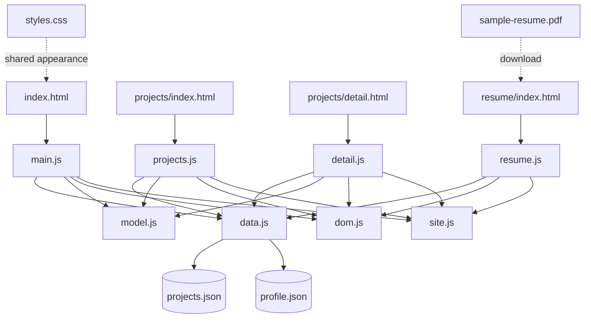

# 01 | アーキテクチャとフォルダーの関係

## 設計の結論

このサイトは「**静的HTML + CSS + ブラウザJavaScript + JSON**」で構成し、サーバー上のアプリケーションプロセス・データベース・認証サーバーを使わない。HTMLは画面の構造、CSSは見た目、JSONは編集可能な内容、JSはデータ取得・検証・描画・ユーザーイベントを扱う。HTMLを増殖させず、すべてのプロジェクト詳細に**1つのテンプレート**を使う。

## 全体のフォルダーツリー

```text
Resume-Website/
├── index.html                # Home
├── guide.html                # サイト上のカスタマイズガイド
├── projects/
│   ├── index.html           # 一覧UIと検索入力
│   └── detail.html          # 1つの汎用詳細テンプレート
├── resume/
│   └── index.html           # 履歴書表示・PDFリンク
├── data/
│   ├── projects.json        # プロジェクトの単一データソース
│   └── profile.json         # プロフィール・スキル・経験
├── assets/
│   ├── css/styles.css       # すべてのページで共有するCSS
│   ├── js/
│   │   ├── data.js          # HTTP取得層（fetch）
│   │   ├── model.js         # 検証・並べ替え・絞り込み（純粋関数）
│   │   ├── dom.js           # DOMパーツ生成と安全な表示
│   │   ├── site.js          # 共通ナビ・フッター
│   │   ├── site-init.js     # guide.html用入口
│   │   ├── main.js          # Home専用の読み込みと描画
│   │   ├── projects.js      # 一覧と検索/フィルター
│   │   ├── detail.js        # URL slugによる詳細描画
│   │   └── resume.js        # profile.jsonから履歴書生成
│   ├── favicon.svg
│   └── sample-resume.pdf
├── tests/
│   ├── model.test.js        # JavaScript純粋関数の単体テスト
│   ├── structure.test.js    # HTML/アセット構造の検査
│   └── test_http.py         # 実HTTPルート検査
├── docs/
│   ├── requirements.md      # 要件→コード→テストの対応
│   ├── deployment.md        # 公開・独自ドメイン・HTTPS・VM
│   ├── customization.md     # サンプルを実データに差し替え
│   └── test-report.md       # 実際のテスト結果
├── scripts/
│   ├── serve.sh             # 簡易HTTPサーバー
│   └── verify.sh            # テストの一括実行
├── .github/workflows/deploy.yml # GitHub Pagesデプロイ
└── learning/                # この学習教材
```

## ファイル間の依存関係



## 各責務の境界

### `data.js`（データアクセス層）

`loadProjects()`、`loadProfile()`はHTTPアクセスとJSONパースに集中する。`fetch()`は失敗するとPromiseがrejectされるが、HTTP 404/500では通常rejectされないので`response.ok`を検査する。画面上のDOM要素については知らない。

### `model.js`（データ操作・検証層）

`isValidProject()`、`normalizeProjects()`、`projectMatches()`、`getProjectBySlug()`、`categoriesOf()`、`formatProjectDate()`は純粋関数として設計。ブラウザの`document`が不要なので、Node.jsの単体テストで直接実行できる。入力配列をソートし直すと別画面に副作用が出るため、コピーしてから並べ替える。

### `dom.js`（表示部品層）

`node(tag, options, children)`はDOM要素を生成し、`projectCard()`は一件分のカードを組み立てる。`textContent`でテキストを設定することで、JSONに`<script>`のような文字が入ってもタグとして解釈しない。画像の代わりにCSSによる小さなモック画面を構成する。

### ページエントリーポイント

- `main.js`: Homeのプロフィールとおすすめ3件をPromise.allで取得して表示。
- `projects.js`: `search`入力・カテゴリを状態として保持し、選別して再描画。
- `detail.js`: URLクエリ`?slug=...`を読み、1件の詳細を生成。
- `resume.js`: プロフィールのスキル・経歴・学歴を要素として作成。
- `site.js`: モバイルメニューと著作権表記の年を全ページで制御。

## どの順序で動くか

1. ブラウザがHTMLを取得・解析する。
2. CSSと`type="module"`のJavaScriptを取得する（モジュールは依存先をimportする）。
3. ページの入口JSが`initSite()`を呼び、共通ナビのイベントを登録。
4. ページに応じて`loadProjects()`等がHTTP GETでJSONを取得する。
5. `model.js`で検証・検索・分類してから、`dom.js`の部品を使い表示する。
6. `input`や`click`イベントで必要な部分を再描画する（サーバーへの新しいアクセスはフィルタのたびには行わない）。

## なぜこの設計なのか

- **責務分離**: データの取得と並べ替えとDOM生成を1つの巨大関数にしない。
- **拡張性**: JSONを1件増やすだけで一覧・詳細の対象が増える。
- **テスト可能性**: 純粋関数の`model.js`にDOMがなく、Nodeのテストランナーで検証できる。
- **公開容易性**: DB/APIキーのない静的サイトはGitHub Pagesへそのまま配備できる。
- **セキュリティ**: 外部データをHTMLとして解釈させる`innerHTML`を使わない。

## 重要な限界

GitHub Pagesの公開、実在する独自ドメイン、DNS、HTTPS証明書は**ソースコードの外側**の運用責任。デプロイ手順を用意しただけでは、公開済み・高稼働率・安全なVMという実績は成立しない。詳しくは`docs/requirements.md`と`docs/deployment.md`を参照。
