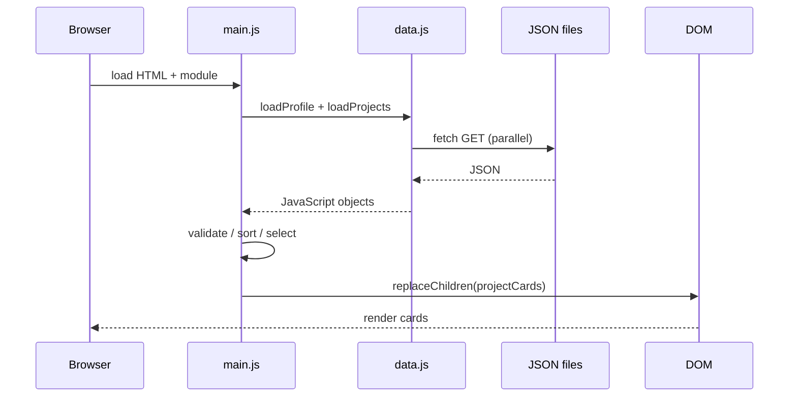

# 03 | 実行フローと変数の変化

## フローA: ホームを表示

1. ブラウザが`index.html`をHTTPで取得し、`<main>`や`#featured-projects`をDOM化する。
2. `<script type="module" src="assets/js/main.js">`をロード。`main.js`は`data.js`、`model.js`、`dom.js`、`site.js`をimportする。
3. `initSite()`がナビのクリックを監視し、現在の年をフッターへセット。
4. `renderHome()`（`async`関数）が走り、`Promise.all([loadProfile(), loadProjects()])`によって2つのJSONファイルを取得する。
5. 取得した`profile.introduction`を`textContent`で挿入。
6. `normalizeProjects(projects)`でID/slug/必須項目を検証し、dateの新しい順にコピーをソート。
7. `.filter(project => project.featured)`でfeaturedがtrueの案件だけ残し、`.slice(0,3)`で先頭3件に絞る。
8. `projectCard(project)`でDOM要素を組み立て、`replaceChildren(...featuredCards)`で表示する。

## フローB: プロジェクト一覧の検索

初回表示後の例：`projects = [FoodieFinder, BudgetMaster, FitTrack, CodeCollab, TravelPlanner]`、`activeCategory='All'`、`search.value=''`。

ユーザーが検索欄に`budget`を入力すると：

|時点|変数・式|結果|
|---|---|---|
|初回|`projects.length`|`5`|
|入力後|`search.value`|`"budget"`|
|判定|`projectMatches(FoodieFinder, 'budget', 'All')`|`false`|
|判定|`projectMatches(BudgetMaster, 'budget', 'All')`|`true`|
|絞り込み|`filtered.length`|`1`|
|描画|`grid.replaceChildren(...cards)`|BudgetMasterのカード1件|

**重要:** `projects`配列の内容そのものは変わらない。filterの結果である新しい配列`filtered`を描画し、文字入力ごとにサーバーへJSONを要求し直すこともしない。

カテゴリーを`Web App`に切り替え、検索文字列が`budget`のままだと`filtered.length===0`となり、`Nothing found`が表示される。`activeCategory`と検索文字列の**両方**が条件に入る。

## フローC: 詳細ページ

ユーザーが`FoodieFinder`カードをクリック：

1. リンク`detail.html?slug=foodie-finder`へ遷移。
2. `new URLSearchParams(window.location.search).get('slug')`が`"foodie-finder"`を返す。
3. `getProjectBySlug(...)`がJSON配列から一致するObjectを返す。
4. `visualForProject()`でデザインモックを構築。
5. `section()`がOverview/Challenge/Approach/Outcomeの各セクションを作る。
6. `content.replaceChildren(...)`で詳細画面を表示。`document.title`を個別タイトルに更新する。

`slug=does-not-exist`なら`getProjectBySlug`は`null`。画面に「Project not found」を表示し、一覧へ戻るリンクを提示する。この場合、静的HTML配信のHTTPステータス自体は200であることに注意。

## フローD: 履歴書ページ

1. `resume/index.html`に静的な見出しとPDFのダウンロードリンクがある。
2. `resume.js`が`loadProfile()`で`profile.json`を取得する。
3. `profile.skills`の各グループから`<section>`/`<h3>`/``を生成する。
4. `profile.experience`の各オブジェクトから経歴の項目を生成する。
5. `profile.resumeFile`が同一オリジンで`.pdf`終わりの場合だけダウンロードリンクを更新する。
6. ユーザーがPDFリンクを押すと、ブラウザが`assets/sample-resume.pdf`を取得する。

**注意:** JSの文章データを変えても、PDF本文は勝手には更新されない。PDFは独立したファイル。

## フローE: スマホメニュー

`site.js`が`[data-menu-toggle]`を取得して、ボタンクリックで`menu.classList.toggle('open')`を実行。CSSの`@media(max-width:720px)`で`.site-nav.open`を表示する。`aria-expanded`はスクリーンリーダーへ開閉状態を伝える属性。Escapeやリンク選択でメニューを閉じる。

## フローF: GitHub Pagesへデプロイ（実際の実行ではなく設定説明）

`git push` → GitHub Actions workflow → Pagesへの静的アセットアップロード → 公開URL → ブラウザがHTML/CSS/JSONを取得。独自ドメインがあれば別途DNSとPages側設定が必要。ワークフローが置かれているだけではサイトは公開されない。

## 典型的な失敗

- `file://`で開く → fetchが失敗 → `catch`でエラー表示。
- `projects.json`のカンマが不正 → `response.json()`でSyntaxError。
- 重複slug → `normalizeProjects()`がErrorをthrow。
- `title`に`<script>`が入る → `textContent`で普通の文字として表示し、スクリプトを実行させない。
- PDFパスが存在しない → HTTP 404（リンク先をDevToolsで確認）。
